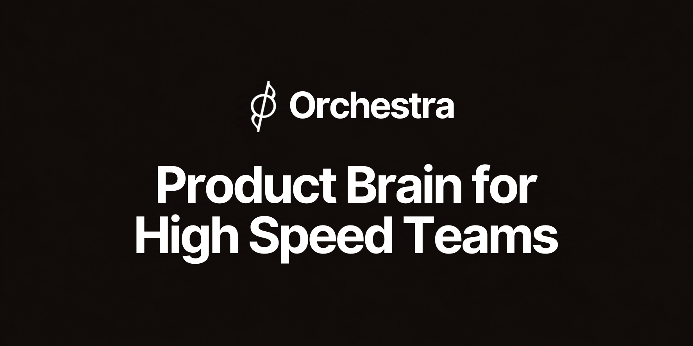
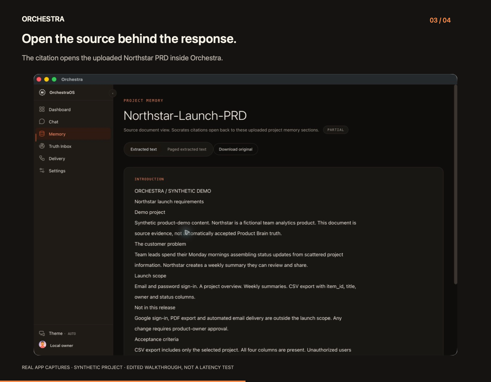
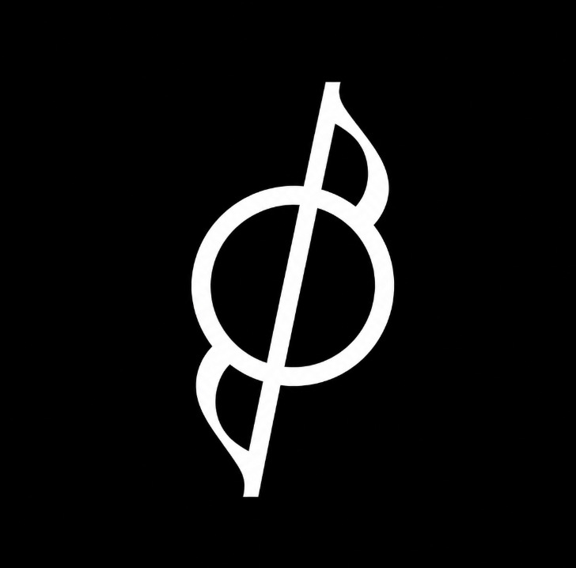

<p align="center">
  
</p>

<p align="center">
  <a href="#watch-orchestra"><strong>Watch Orchestra</strong></a> &nbsp; · &nbsp;
  <a href="#start-with-one-project"><strong>Get started</strong></a> &nbsp; · &nbsp;
  <a href="docs/desktop/release/README.md">Release status</a> &nbsp; · &nbsp;
  <a href="CONTRIBUTING.md">Contribute</a>
</p>

Your PRD says one thing. A conversation changes the scope. Your coding agent still has yesterday's context.

**Orchestra is a Product Brain for High Speed Teams.** Product managers and engineers use it to find the evidence behind a requirement, review what changed, and give coding agents the context the team actually approved.

*Public source preview for Apple Silicon Macs. [Build an internal app from source](docs/desktop/release/BUILD.md). No public installer is available.*

## Watch Orchestra

### Orchestra in 60 seconds

Someone asks for PDF export. See how the team checks the spec, records its decision, and traces it back to the source.

https://github.com/user-attachments/assets/5d189bb8-0307-433b-92e7-6869750fa07f

<a id="open-the-evidence-behind-an-answer"></a>

### A three-minute product walkthrough

Open the passage behind a Socrates answer, compare the proposed change with the original wording, and follow the approval through Project Memory into Agent Preflight.

https://github.com/user-attachments/assets/c08ab2ea-2a30-4df0-83d5-9075798fa05c

Both films have English captions. [Transcripts and recording details](docs/desktop/media/PRODUCT-FILM.md).

## Ask a product question. Check the source.

“What is in scope for launch, and what is still only a request?”

**Socrates** answers from project evidence with citations you can open. **Memory** keeps the underlying documents available for inspection. **Deep Research** turns a larger question into a source-linked report you can save alongside the project.

Accepted decisions and ordinary source material remain distinct. Select **Recorded decisions** in Deep Research to check actual project approvals. A document saying “approved” is not itself a recorded approval, and a saved AI report remains generated evidence.

### Start with a question that matters

| Ask Orchestra | What to inspect |
| --- | --- |
| “What is in scope for launch?” | A source-linked answer, with requests separated from recorded decisions. |
| “Where did this requirement come from?” | The original document or conversation behind the claim. |
| “What is still missing before we build?” | Evidence gaps, unresolved questions and task-specific Preflight blockers. |
| “What context should my coding agent use?” | A scoped context pack that the agent retrieves by its exact project and pack ID. |

<p align="center">
  
</p>

## Review a change before it becomes the plan

“Can we add PDF export?” should start a decision, not silently rewrite the requirements.

**Truth Inbox** brings proposed changes and review findings into one place. **Change Packets** connect a proposal to its evidence and affected areas, giving authorised reviewers the context to decide.

The decision chain is explicit:

**Source evidence → proposed change → authorised review → accepted Product Brain → implementation evidence**

**Product Brain** and **Live Doc** make accepted context available to the team. **Timeline** preserves the history behind it. You can inspect what was agreed, what prompted the change and what still needs a decision.

## Give your agent the context you actually agreed on

**Agent Preflight** assembles a task-specific pack: scoped evidence, accepted product context, implementation boundaries, an acceptance checklist and open questions. Unresolved questions and blockers remain visible.

1. Describe the work and inspect the Preflight pack.
2. Pair your client and retrieve that **exact pack ID** through Orchestra MCP.
3. Link the agent's implementation evidence to the same pack for **Postflight** review.

The pack connects intent to reported work. Postflight evidence does not automatically approve new requirements or certify a release. The currently qualified desktop clients are **Codex and VS Code**.

## Bring the context you choose

Start with selected files, folders or local Git repositories. Connect authorised **GitHub**, **Google Drive** and **Slack** sources when you need engineering, document or conversation evidence alongside the product requirements.

Source selection is explicit. Orchestra does not automatically index your home directory, and connecting a shared workspace does not publish your local projects.

## Start with one project

After building or receiving an authorised internal package:

1. Choose **Local** and create a project. No hosted signup is needed.
2. Add a source document, wait for processing, then open it in Memory.
3. For AI generation, open **Settings → Desktop AI**: select a provider, add your API key, choose a model, **Test connection**, then **Save and restart**.
4. Ask Socrates a specific question and open a citation to check the answer.

Without an AI key, saved-document reading and evidence search remain available. External AI use requires network access and provider credit; no AI credits are included. Start with [the setup and compatibility guide](docs/desktop/release/USER-GUIDE.md#add-an-api-key).

## One Mac or a shared team workspace

| | Local workspace | Shared workspace |
| --- | --- | --- |
| Project data | Application-managed database and files on your Mac | Your selected server |
| Identity and decisions | Installation-local owner | Server-owned identity, membership and authorisation |
| Offline access | Read and search saved evidence | Optional expiring, read-only metadata cache; off by default |
| Changes | Stay local unless explicitly transferred | Require live server authorisation |

Orchestra manages its own **PostgreSQL/pgvector** runtime locally. The packaged app does not require Docker or a separately installed database. Team operators can use the versioned [self-hosting guide](infra/self-host/v1/README.md) with a compatible trusted HTTPS server.

## Privacy

- **Your sources, your selection.** Import only the files, repositories and provider resources you intend to use.
- **Your AI configuration.** Relevant request context goes to the provider you choose. Local keys do not configure or get uploaded to a shared server.
- **Protected credentials.** Secrets use OS-protected storage outside the web renderer. Documents and the database rely on your Mac account and disk encryption; full application-level encryption is not claimed.
- **Visible network boundaries.** AI and connectors contact their providers; shared mode contacts its server. The current UI also references Google Fonts, so local mode does not mean zero network traffic.

Read the [usage, privacy and recovery guide](docs/desktop/release/USER-GUIDE.md) for retention, export and backup boundaries.

## Build from source

You’ll need **an Apple Silicon Mac, Node.js 24/npm, Xcode command-line tools, Perl/tar and network access**. Start in a fresh checkout.

```sh
git clone https://github.com/KarthikRamesh9149/Orchestra.git
cd Orchestra
```

Follow the [complete build and verification steps](docs/desktop/release/BUILD.md). The packager prints the app path and writes it to `.desktop/latest-package.txt`. The resulting app is for internal evaluation; do not bypass macOS security warnings.

<details>
<summary><strong>Current qualification and release boundaries</strong></summary>

- **Platform:** Apple Silicon Mac internal beta, unsigned and manual-update-only. Windows, signing/notarisation, automatic updates and two-physical-computer qualification are deferred.
- **AI:** OpenAI has real-account Socrates, Deep Research, streaming and restart evidence on the tested Mac configuration. Anthropic, Gemini and compatible API adapters remain previews pending real-account workflow qualification; models must meet the required protocols.
- **Connectors:** GitHub, Drive and Slack are available for scoped testing. New-account and new-workspace onboarding still needs qualification before customer rollout.
- **Distribution:** Internal packages are not public downloads or proof that a shared-team deployment is ready.

[Release status](docs/desktop/release/README.md) · [Desktop contract](docs/desktop/CONTRACT.md) · [Provider guide](docs/desktop/release/USER-GUIDE.md#add-an-api-key) · [Notice review](docs/desktop/THIRD-PARTY-REVIEW.md)

</details>

## Project documentation

[User guide](docs/desktop/release/USER-GUIDE.md) · [Architecture](docs/desktop/ADR-001.md) · [Self-hosting](infra/self-host/v1/README.md) · [Recovery](docs/desktop/INTERNAL-UPDATE-RECOVERY.md) · [Contributing](CONTRIBUTING.md) · [Report a security issue](SECURITY.md)

Maintainer and recovery owner: **Karthik Ramesh**. Support: **hello@orchestraos.dev**. Include the app version and reproduction steps, not credentials or customer records.

First-party code is [Apache-2.0](LICENSE). Third-party components retain their own [licences and notices](docs/desktop/THIRD-PARTY-REVIEW.md).

<p align="center">
  
</p>
